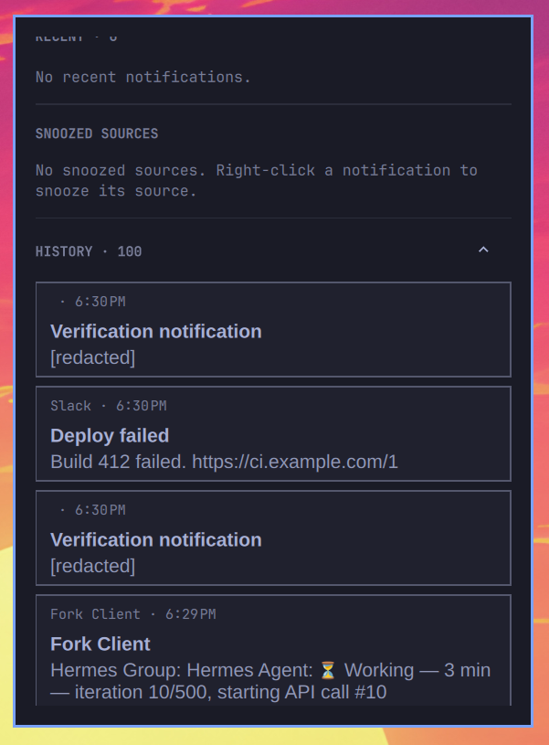

<!--
 ▄█████▄    ▄███████████▄   ▄███████   ▄███████▄  ▄███████    ▄█████▄   ▄████████  ▄███████▄
███   ███  ███   ███   ███  ███   ███  ███   ███  ███   ███  ███   ███  ███   ███  ███   ███
███   ███  ███   ███   ███  ███   ███  ███   ███  ███   ███  ███        ███   ███  ███   ███
███   ███  ███   ███   ███  ███▄▄▄███  ███▄▄▄███  ███▄▄▄███  ███ ▄▄▄▄▄  ███▄▄▄     ███▄▄▄██▀
███   ███  ███   ███   ███  ███▀▀▀███  ███▀▀▀▀▀▀  ███▀▀▀███  ███ ▀▀███  ███▀▀▀     ███▀▀▀██▄
███   ███  ███   ███   ███  ███   ███  ███        ███   ███  ███   ███  ███   ███  ███   ███
███   ███  ███   ███   ███  ███   ███  ███        ███   ███  ███   ███  ███   ███  ███   ███
 ▀█████▀    ▀█   ███   █▀   ███   █▀    ▀█        ███   █▀    ▀█████▀    ▀███████   ███   █▀
-->

A notification daemon for [Omarchy](https://omarchy.org) with grouped
notifications, inline actions and screen-sharing detection. Replaces the built-in
notification service and follows your Omarchy theme.

> **This is a fork.** [dakai/omapager-ai](https://github.com/dakai/omapager-ai)
> tracks [njpatel/omapager](https://github.com/njpatel/omapager) and adds a
> preferences window, an optional model layer for duplicate detection and
> suggested actions, a local sensitive-text filter, saved-file actions, and
> verification codes in Chinese, Japanese and Korean text. The plugin id stays
> `njpatel.omapager`, so it installs over the original.


## Features

**Screen-sharing detection.** When you share a screen, window or area through
the Hyprland portal, Omapager offers to snooze notifications for 30 minutes,
1 hour or 4 hours. Nothing is muted until you choose. You can disable these
suggestions in preferences.

**Grouped notifications.** Messages from the same source stack together. Hover
to expand the group and read or act on each notification.


[Watch the demo video](assets/deck.mp4).

**Theme support.** Follows your Omarchy theme.

**Code, link and phone actions.** Copy verification codes and phone numbers, or
open links, directly from a notification. Multiple codes get separate buttons.
A phone number in the same message is never taken for a code, and neither is a
number the keyword window happened to cut in half. Chinese, Japanese and Korean
verification texts are recognised too (`验证码`, `驗證碼`, `激活码`, `認証コード`,
`인증번호` and similar), which need their own matching because CJK has no word
boundaries for the English keywords to anchor on.


**Per-notification actions.** Use app-provided actions such as Mark as read
without opening the app.

**Inline replies.** Reply to supported KDE Connect messages without leaving the
notification.


**Window focus.** A card click focuses its app or browser window and leaves the
card where it is; web notifications open their source URL when no matching
window is available. `allowDefaultActionOnCardClick` additionally lets a click
invoke the sender's default action. The close control and middle-click dismiss,
so a mis-click cannot lose a notification.

**Snooze and Do Not Disturb.** Right-click a notification to snooze its source.
Use the panel to snooze everything or toggle Do Not Disturb.

**Verification-code exception.** Let login codes through while notifications
are snoozed or silenced. Turn this off with the key button in the panel.

**Held notifications.** Read messages received while a source was snoozed in
the panel's Held Back section.

**Recent notifications.** Review recently dismissed or expired notifications
by expanding Recent in the panel, or keep it open with `alwaysShowRecent`.
Each row keeps the offers its card had - copy a code, open a link, copy a number,
snooze the source, remove the row.
The list is per session: notifications still on screen come back after the
shell reloads, dismissed ones do not. History is the durable list.

**Notification history.** Expand History to read up to 100 closed notifications,
newest first, including messages held while snoozed or silenced. Unlike Recent,
this list survives shell restarts and refreshes each time the panel opens.
Click a card to expand its message, then scroll to read the rest. `historyHours`
controls retention; `0` disables disk history. Detected verification codes stay
redacted.



**Source icons.** Use local icons or fetch missing website icons automatically.
Set `fetchRemoteIcons` to `false` in the config to disable fetching.
Sender-provided image files are decoded by a bounded helper and kept in memory
for the live toast. Rejected files fall back to the resolved source icon.

**Secrets stay off the screen and off the disk.** API keys, tokens, private
keys, passwords inside connection URLs, card and account numbers, email
addresses and phone numbers in a message can be masked on the card, and are
redacted from history regardless. Set `sensitiveFilter` to `mask` or
`redact`; the rules run locally and no model is involved.

**Optional model layer.** Omapager can ask a model to recognise a duplicated
message from a second source, or to point out an action a card should offer. It
is off until you choose a provider. Two questions with two kinds of answer: a
duplicate is a yes or no, an action is a suggestion that must point at text the
notification already contains. The model cannot add a link, a path or a command,
so a prompt injected through a message body can at worst make a card offer
nothing useful. The API key is kept in the desktop keyring, not in `shell.json`.

**Saved files.** When a message names a file it just saved, the card grows a
File button: Reveal, Properties, Open, or copy the path. A notification surface
cannot host another application's real context menu; these four are what that
menu is used for, and `fileManager` picks which application answers.

## Install

Check the [requirements](#requirements), choose one installation method in
step 1, then enable Omapager in step 2.

### 1. Install

#### This fork, via Git

The plugin id is unchanged, so this installs over an existing Omapager:

```bash
git clone --branch feature/llm-settings https://github.com/dakai/omapager-ai.git \
  ~/.config/omarchy/plugins/njpatel.omapager
```

`main` on the fork will carry these changes once the branch is merged.

#### Upstream releases via the marketplace

Find Omapager in the [Omarchy Plugin Marketplace](https://omarchyplugins.com/)
and run its install command:

```bash
omarchy plugin add https://github.com/njpatel/omapager.git
```

That installs upstream, without the features listed at the top of this file.
Until a stable release is approved, the marketplace installs Git HEAD.

### 2. Enable Omapager

After either installation method, disable the built-in notification service and
enable Omapager. Only one notification daemon can run at a time.

```bash
omarchy-shell shell rescanPlugins
omarchy plugin disable omarchy.notifications
omarchy plugin enable njpatel.omapager --section center --after omarchy.indicators
omarchy restart shell
```

### Updates

For this fork, pull the branch you installed:

```bash
git -C ~/.config/omarchy/plugins/njpatel.omapager pull --ff-only
omarchy restart shell
```

[Release notes](https://github.com/dakai/omapager-ai/blob/feature/llm-settings/RELEASE.md)
describe each update. Do not use `omarchy refresh shell`, which resets your shell
configuration.

### Remove Omapager

```bash
omarchy plugin disable njpatel.omapager
omarchy plugin remove njpatel.omapager
omarchy plugin enable omarchy.notifications
omarchy restart shell
```

Removal keeps notification history, icon cache and other state in
`~/.local/state/omarchy/omapager/`. Delete that directory separately if you also
want to remove the stored data.

## Settings

Two places, one setting per place. The panel's cog opens a short page of
toggles; a row at the end of that page opens the full preferences window for the
settings that need room - provider, endpoint, model, key, and what the model may
do.


Changes save to the `njpatel.omapager` bar-widget entry in
`~/.config/omarchy/shell.json`. You can edit the other options there too.
`edgeSpacing`, `fetchRemoteIcons` and `requireSandbox` are config-only. Defaults
below apply to new configurations, not choices you have already saved.

### Omapager options

| Option | Default | Purpose |
| --- | --- | --- |
| `stacking` | `source` | `source` gives each sender a deck. `all` uses one deck. |
| `displayMode` | `active` | `active` follows focus for new decks. `specific` uses `displayName`. `all` mirrors notifications. Visible decks stay put in active mode. |
| `displayName` | empty | Output for specific mode, such as `DP-1`. Omapager keeps the selection while disconnected and falls back to a connected display. |
| `fullscreenOverlay` | `off` | Step aside for fullscreen windows so the compositor can scan them out directly. `all` steps aside for any fullscreen window, `steam` only for Steam games (`steam_app_*`); both come back to show a notification. `all-away` and `steam-away` never cover the fullscreen display and send notifications to another display, or to history when there is none. |
| `edgeSpacing` | `12` | Gap from the bar and screen edges, in logical pixels from 0 to 64. Config-only. |
| `showCountdown` | `false` | Show the time-remaining animation. Turning it off does not change expiry. |
| `offerSnoozeWhenSharing` | `true` | Suggest a timed snooze when portal sharing starts. Never mute automatically. |
| `fontScale` | `100` | Notification text size as a percentage, from 75 to 200. Does not resize bar or panel text. |
| `actionsAlign` | `right` | Align action buttons to the `right` or `left`. |
| `hideSettingsAction` | `true` | Hide the browser's repeated Settings action. |
| `snoozeDurations` | `30, 60, 240, tomorrow` | Offer `15`, `30`, `60`, `120`, `240` or `480` minutes, or `tomorrow`. An empty selection uses the defaults. |
| `wakeHour` | `8` | Wake hour for `tomorrow`, from 0 to 23. Currently `0` falls back to `8`. |
| `smartRaise` | `true` | Match notification websites against browser window titles when focusing a window. |
| `alwaysShow` | `false` | Keep the bar indicator visible when nothing is held back. |
| `codesBypassQuiet` | `true` | Let verification codes through snooze and Do Not Disturb. |
| `timeFormat` | `system` | Use the `LC_TIME` locale, or choose `24h` or `12h`. |
| `sourceLimit` | `8` | Number of quietened sources listed in the panel, from 2 to 20. |
| `heldPerSource` | `10` | Held notifications shown per source, from 3 to 25. |
| `recentCount` | `5` | Recent notifications shown in the panel, from 1 to 20. Clears on shell restart. |
| `fetchRemoteIcons` | `true` | Fetch missing website icons. Turning it off keeps local and validated cached icons. Requires Pillow. Config-only. |
| `requireSandbox` | `false` | Require Bubblewrap instead of allowing helpers to run directly when it is unavailable. Config-only. |
| `allowDefaultActionOnCardClick` | `false` | Allow the app's default action on a card click. Off by default: a click on the card body then does nothing, so a mis-click cannot lose a notification. Middle-click dismisses; every offer and sender action is a button. |
| `historyHours` | `24` | Keep disk history for `1`, `24` or `168` hours, with a 100-entry cap. `0` disables it. |
| `clipboardTimeout` | `60` | Clear copied codes after `30`, `60` or `90` seconds, unless the clipboard has changed. |
| `swapMouseButtons` | `false` | Make right-click the plain click and left-click open the panel, on the bar indicator only. Cards keep right-click for the source menu. |
| `alwaysShowRecent` | `false` | Open the panel and the latest five notifications are already listed, instead of waiting behind the Recent fold-out. |
| `sensitiveFilter` | `off` | `mask` hides credentials and personal data in the card while keeping the sentence; `redact` replaces the message. History is always redacted regardless. |
| `fileManager` | `auto` | `nautilus`, `dolphin`, `thunar` or `nemo` for a saved file's Reveal and Properties actions. `auto` uses the desktop's registered file manager. |
| `llmProvider` | `off` | An OpenAI-compatible endpoint used to spot duplicates and suggest buttons. `ollama`, `lmstudio` and `llamacpp` are local presets; `openrouter`, `openai` and `deepseek` are remote; `custom` uses `llmBaseUrl`. Off contacts nothing. |
| `llmBaseUrl` | empty | Endpoint for `custom`. Must end in `/v1`. Plain `http` is accepted only for `127.0.0.1` or `::1`. |
| `llmModel` | empty | Model name. Empty uses the provider's default. |
| `llmDedupe` | `true` | Show one card when the same message arrives from two sources. Identical text is merged either way; this also merges wording that differs but means the same. |
| `llmDedupeModel` | empty | A second, cheaper model used only for the duplicate question. Empty uses the model above. A small or flash model is enough: the answer is one boolean. |
| `llmDedupeApi` | `chat` | `chat` sends both notifications to a chat model and reads a JSON reply. `systemone` sends one yes/no question to a System One model such as Jev (`group/jev` at Magpie), which answers with a probability: faster, cheaper, and nothing to parse. A card is merged at 0.7 or above. |
| `llmIntent` | `true` | Let the model point out a code, link, phone number or file the card should offer. A suggestion must point at text the notification already contains. |

The API key is not a `shell.json` option and cannot be set there. Choose a
provider, then open the preferences window and paste the key: it goes to the
desktop keyring (libsecret) and is never written to disk, argv or a log. On a
machine with no secret service the model section disables itself.

Add options to the existing widget entry. This example is not a complete
`shell.json` file:

```json
{
  "id": "njpatel.omapager",
  "edgeSpacing": 12,
  "showCountdown": false,
  "fontScale": 100,
  "historyHours": 24
}
```

### The model layer

Off until a provider is chosen. Two separate jobs, which can use two separate
models.

**Duplicates.** The same message often arrives twice, once in the app and again
in a mail or chat bridge. Two stages:

1. **Local, always.** The words are normalised - lowercased, URLs and
   punctuation removed - and compared against everything still on screen from a
   *different* source within two minutes. Nothing is sent anywhere and no model
   is involved. Identical text is merged even with the model layer off.
2. **Model, optional.** When the words differ but look alike, the model is asked
   about that one pair. It is shown both messages, not just the new one, which is
   the whole question. A "yes" is then re-checked locally: a card from another
   source must still be on screen and must read at least 60% alike. The newer
   card closes; the older one stays.

Critical notifications are never merged, and a source is never compared against
itself - one app talking twice is that app talking twice.

**Suggested actions.** The model may point out a code, link, phone number or
file the card should offer. A suggestion is accepted only when its value appears
verbatim in the text the card is already showing, and then only if it
re-validates as the kind it claims to be. `reply` and `action` are dropped
outright: those belong to the sender's own action list, which the model cannot
see or extend.

**Two ways to ask.** `llmDedupeApi` picks the protocol for the duplicate
question:

- `chat` - both notifications go to an OpenAI-compatible chat model and the JSON
  reply is parsed.
- `systemone` - one yes/no question goes to a [System One](https://docs.typesafe.ai)
  model such as Jev (`group/jev` at Magpie). It answers with a probability
  instead of prose: no generation, nothing to parse, roughly 0.8 s against 2.5 s
  for a chat model and stable between runs. A card merges at 0.7 or above, the
  vendor's recommended yes threshold.

**Cost and failure.** One request is in flight at a time, the queue is capped,
and nothing waits on the network before a card is drawn. A provider that is down
or slow costs the feature and nothing else; cards still arrive, and the guard
that drops a stuck helper is 20 seconds, above the helper's own deadline.

**Presets.** `ollama`, `lmstudio` and `llamacpp` assume a local server on its
default port and speak plain `http` on loopback, which never leaves the machine.
`openrouter`, `openai` and `deepseek` are `https` on port 443 through the pinned
transport. `custom` takes any OpenAI-compatible base URL ending in `/v1`.

**Checking it.** The preferences window's *Test connection* asks the provider for
its model list, then sends one small question to the duplicate model if one is
set, so a model id that is listed but refuses every call is reported rather than
silently never merging. The same check is available without the UI:

```bash
bin/omapager-run-llm status custom https://example.com/v1 model-name group/jev systemone
# {"reachable": true, "detail": "ok",
#  "dedupe": {"model": "group/jev", "ok": true, "detail": "ok"}}
```

`omarchy-shell omapager probe` reports the live state instead: the provider, the
two models, which API each question uses, the queue depth and the last answer.

### Sensitive text

`sensitiveFilter` decides how much of a credential the card may draw. The rules
run locally; no model is involved.

| Setting | Effect |
| --- | --- |
| `off` | The card shows the message as written. History is still redacted. |
| `mask` | The value becomes `••••••` and the kind is kept, for example `•••••• (API_KEY)`. The sentence around it stays readable. |
| `redact` | The value becomes `••••••` with no kind. |

Recognised by shape: private keys, API keys (`sk-`, `ghp_`, `AKIA`, `AIza`,
`xox`, `hf_`, `gsk_`, `npm_`, `pypi_`, and similar), JWTs, passwords inside
connection URLs, email addresses, IBANs, card numbers that pass Luhn, and phone
numbers. Recognition is heuristic: an unusual format is not found, and an
ordinary string that happens to match a shape is hidden.

Two layers exist on purpose. `Redact.js` runs in the shell for what is drawn;
`bin/omapager-store` has its own copy for what reaches disk. A bug in one cannot
let a secret reach the screen and the disk at the same time, and the tests check
that the two agree. Persistence acts on credentials only - a message that signs
off with an email address is still a message, and destroying the whole history
row because of it would lose more than it protects.

### Appearance inherited from Omarchy

Theme overrides belong in `~/.config/omarchy/shell.toml`, not the plugin's
`shell.json` entry. Your overrides take precedence over the active theme and
apply to other Omarchy components that use the same settings.

| Appearance | Omarchy setting |
| --- | --- |
| Notification colours | `[notifications]` background, text, border and countdown colours |
| Card border width | `[notifications] border-width`, including per-side overrides. The fallback is 2 logical pixels at the default scale, as in stock notifications. |
| Panel colours and border | `[popups]` |
| Corner rounding | Hyprland's `decoration:rounding` |
| Text sizes | `[font]`. Titles and message text use Liberation Sans. Controls use the shared UI font. |
| Button and switch states | `[controls]` |
| Internal spacing and padding | `[spacing]` |

For example, set the notification border width in `~/.config/omarchy/shell.toml`:

```toml
[notifications]
border-width = 2
```

The `edgeSpacing` option is separate from Omarchy's outer gaps. It keeps the
configured distance regardless of the theme's spacing scale or Hyprland's
`general:gaps_out`. At 2x display scaling, 12 logical pixels occupy 24 physical
pixels.

### Sharing detection

Omapager detects screen, window and area sharing through the Hyprland portal.
It uses stream metadata, not your screen content. Click the sharing indicator
to snooze for 30 minutes, 1 hour or 4 hours, or choose Not now.

An existing global snooze or Do Not Disturb suppresses the offer. Each sharing
period gets one offer, even with multiple streams. A chosen snooze lasts for its
selected duration, regardless of when sharing ends. Critical alerts and the
configured verification-code exception still apply.

Portal-based recording can trigger detection. Screenshots, direct VNC capture and
apps that bypass the portal do not. Omapager tracks up to 64 video-source nodes.
Restarting the shell during a share can show the offer again. Disable suggestions
in preferences or set `offerSnoozeWhenSharing` to `false`.

## The bar

The indicator appears while notifications are held back or a sharing offer is
waiting. Hover the centre of the bar to reveal it at other times.

| Indicator | Meaning |
| --- | --- |
| Plain bell, full strength | Notifications are on |
| Crossed-out bell in grey | Do Not Disturb |
| Sleeping bell in the accent colour | A source or all notifications are snoozed |
| Sharing icon in the accent colour | Sharing detected. Click to choose a snooze. |

Grey rather than red for Do Not Disturb: silencing is a decision, not a fault,
and the slashed bell already says "off". The ordinary state is a plain bell at
full strength, so a working desktop never looks switched off.

Left-click the bell to silence or resume notifications. Right-click to open the
panel for Recent, History, held messages and snooze controls. `swapMouseButtons`
trades the two, on this icon only; cards keep right-click for the source menu.

## Keybindings

Omarchy's existing comma-key shortcuts work without configuration:

| | |
| --- | --- |
| `SUPER` `,` | dismiss the newest notification |
| `SUPER` `SHIFT` `,` | dismiss the whole stack the newest one is in (or the one you have open) |
| `SUPER` `CTRL` `,` | toggle silencing |
| `SUPER` `ALT` `,` | invoke the newest one, as clicking it would |
| `SUPER` `SHIFT` `ALT` `,` | put the last few back on screen |

Omarchy screenshot toasts carry `omarchy-exec-argv`. Clicking such a card, or
Super+Alt+`,`, runs that editor. The same gesture opens a Taildrop notification's
local file or launches Omarchy's configured agent to diagnose a crash by PID.
Crash details are retrieved by the agent, not taken from notification-supplied
metadata. Taildrop opening requires an existing non-executable regular file at an
absolute path; URLs, traversal, final symlinks and `.desktop` launchers are
refused. These actions are checked again when activated and are never restored
from history. They do not require `allowDefaultActionOnCardClick`.

A card click on an ordinary notification focuses the sender's window, or opens
the source URL when there is none, and leaves the card in place. It never
dismisses. Only cards whose sender declared an action - a screenshot editor, a
saved file - act on a click, because that click is the thing the sender asked
for.

### Optional bindings

Check for conflicts with `omarchy menu keybindings --print` before adding these
to `~/.config/hypr/bindings.lua`. Use `hl.unbind` to remove a conflicting binding.

```lua
-- Copy the newest code and dismiss its notification.
o.bind("SUPER + ALT + C", "Copy code from newest notification",
       "omarchy-shell omapager offer code")

-- Snooze all sources for an hour.
o.bind("SUPER + CTRL + ALT + comma", "Snooze all notifications for an hour",
       "omarchy-shell omapager snoozeAll 60")

-- Toggle the notification panel.
o.bind("SUPER + CTRL + SHIFT + comma", "Notification options",
       "omarchy-shell omapager.panel toggle")
```

## Scripting

```
omarchy-shell omapager count            how many are on screen
omarchy-shell omapager clear            dismiss them
omarchy-shell omapager dnd              toggle Do Not Disturb
omarchy-shell omapager expand           open the deck, as hovering would
omarchy-shell omapager offer code       take the front card's offer (code|link|phone)
omarchy-shell omapager act reply        invoke one of the sender's actions
omarchy-shell omapager reply "text"     answer the front card ("" opens the field)
omarchy-shell omapager snooze 60        quieten the front card's source, in minutes
omarchy-shell omapager snoozeAll 60     quieten everything for 60 minutes, or wake it
omarchy-shell omapager codes off        stop letting verification codes through
omarchy-shell omapager unsnooze ""      wake everything ("" for all, or a source key)
omarchy-shell omapager snoozes          what is snoozed, and until when
omarchy-shell omapager stack source     switch stacking mode
omarchy-shell omapager align right      switch which end the buttons sit at
omarchy-shell omapager probe            show runtime configuration and helper status as JSON

omarchy-shell omapager.panel toggle     the panel
omarchy-shell omapager.panel expand x   open a source's held list, as clicking it would
omarchy-shell omapager.panel openSettings  notification preferences
```

`probe` is the headless source of truth: the deck, the quiet state, the sandbox
mode, the display routing, the model provider and both of its models, the queue
depth, the last answer, and how many rows Recent holds.

The helpers can be exercised on their own, which is how a provider or a keyring
is checked without touching a notification:

```bash
bin/omapager-run-llm status custom https://example.com/v1 model-name
bin/omapager-run-llm models custom https://example.com/v1 model-name
bin/omapager-run-secret status          # {"available": true, "stored": false}
```

`bin/omapager-llm` also takes `ask` and `judge` verbs, reading one notification
as JSON on stdin; `judge` is the System One path and needs a comparison card.

## Demo

```bash
bin/omapager-demo                       # the everyday scenes
bin/omapager-demo --scene interactive   # codes, links, and the sender's buttons
bin/omapager-demo --scene routing       # where a click sends you, per source
bin/omapager-demo --scene reply --keep --timeout 30000  # local inline-reply demo
bin/omapager-demo --scene close         # dismiss a stack without moving the pointer
bin/omapager-demo --replay 40           # your own notifications, re-sent
bin/omapager-demo --list
```

The demos use the original named conversations and source icons. Add `--keep`
to leave existing notifications on screen.

The routing scene lists the window or URL each notification should open. The
reply scene lets you type and send a reply without contacting a phone. It saves
the latest reply in `~/.local/state/omarchy/omapager/reply-demo/reply.json`.
Each run creates a new demo session, which expires after 30 minutes.

`--scene close` keeps three cards on screen with live default actions. Repeatedly
click the front close control without moving the pointer, waiting for each card
to settle. All three should dismiss; any `default` output means a card opened
instead.
For the default-action check, enable `allowDefaultActionOnCardClick` in the
lab's widget settings first; strict mode does not invoke default actions on
card-body clicks.

## Security

### Automatic website icons

Omapager checks local icons and its cache before fetching from a website.
Website-icon fetching is on by default. Set `"fetchRemoteIcons": false` in the
widget's `shell.json` entry to stop requests and cancel the active lookup.
Local and validated cached icons still work. Saved opt-outs survive upgrades.

Requests expose your IP and request time to the source website and its icon
hosts. They contain no notification text, verification codes, browser cookies or
authentication headers. Omapager does not use a third-party favicon service or
guess parent domains.

These protections apply with or without Bubblewrap:

- HTTPS on port 443 with TLS 1.2 or newer. Omapager rejects URL credentials,
  IP literals and local or private destinations.
- Every DNS answer must be public. Connections use those checked addresses,
  with certificate validation for the original hostname.
- Redirects and icon URLs receive the same checks. Proxy environment variables
  cannot bypass them.
- Downloads have redirect, byte and time limits. Pillow validates image formats
  and dimensions, then re-encodes icons as small PNGs. Remote SVGs are rejected.

Keep Python, Pillow and the system libraries updated. These checks do not protect
against another process running as your user and modifying the local cache.

### What the model layer sends

This is the only part of Omapager that sends notification text off the machine,
and it does nothing until a provider is chosen.

- **What is sent.** The summary and body of a notification, after the display
  filter has run, so a credential the card was told to mask is not in the
  request. Nothing else: no history, no images, no other notifications.
- **Where it goes.** The provider you configured. Local presets (`ollama`,
  `lmstudio`, `llamacpp`) talk to `127.0.0.1` or `::1` over plain `http` and
  never leave the machine. Remote endpoints are `https` on port 443.
- **How it is checked.** Remote requests use the same pinned-address transport
  as icon fetching: every DNS answer is validated before connecting, TLS is
  validated against the original hostname, and proxies in the environment cannot
  redirect it. A redirect from an API endpoint is refused rather than followed,
  because following one would carry the Authorization header to a host you did
  not choose.
- **What it can do.** Return advice that is re-checked locally. It cannot open a
  URL, run a command or dismiss a notification by itself.
- **When it fails.** Requests are abandoned after 20 seconds, one at a time, and
  the feature switches itself off for that notification. A card is never held
  back waiting for a model.

One deliberate exception in the sandbox: the model helper is the only one that
is both networked and connected to the session bus, because it must reach the
provider and the keyring. It cannot read the notification store. See
[the sandbox table](docs/SANDBOX.md).

### The API key

Kept in the desktop keyring through libsecret. It is not in `shell.json`, not in
the state directory, not in a command line, and not in any log line. The
preferences window only ever learns whether one is stored, never its value. On a
machine with no secret service the model section disables itself; there is no
plaintext fallback.

### Optional helper sandbox

Storage, icon, KDE Connect, secret and model helpers use Bubblewrap when its
startup check succeeds. Otherwise they run directly as your user, with your
account's normal filesystem and network access. Input validation and resource
limits still apply.

Set `"requireSandbox": true` in the widget's `shell.json` entry to block helpers
when sandboxing is unavailable. This affects persistence, icon lookup, phone
replies and the model layer. The saved policy applies before startup helpers run.
A failed helper is never retried without its sandbox.

Sandboxed helpers receive access to the files they need. Remote icons and remote
model endpoints still need network access, and KDE Connect receives the session
bus without destination filtering. The secret helper gets the bus and nothing
else. Bubblewrap does not isolate the QML shell itself.

Run `omarchy-shell omapager probe` to check whether helpers use `sandboxed`,
`direct` or `blocked` mode. See [the security architecture](docs/SECURITY_ARCHITECTURE.md)
for the exact limits and access rules.

### Stored notifications and clipboard

Disk history defaults to 24 hours and 100 entries. Omapager redacts detected
verification-code notifications before saving them, and with `sensitiveFilter`
set it redacts credential shapes as well, but detection cannot identify every
secret. Copied codes clear after the configured timeout only if the clipboard
still contains the same code.

The Recent list is session-only memory. Its drawn text is redacted exactly as
history is; the offers behind each row's buttons (a code, a link, a number) are
held in memory for the session so the row stays actionable, and are never written
to disk. Removing a row, or closing the shell, drops them.

State lives in `~/.local/state/omarchy/omapager/`. The API key is the one thing
that does not: it lives in the desktop keyring, never here. See
[settings](#settings) for retention and clipboard options, and
[SECURITY.md](SECURITY.md) to report a vulnerability.

## Requirements

- Omarchy with Quickshell 0.3.x and Hyprland.
- Python 3 for the helpers.
- Pillow, packaged as `python-pillow`, for remote website icons and sender-provided
  image files. Without it, sender files fall back to local theme icons.
- Bubblewrap, packaged as `bubblewrap`, is optional unless `requireSandbox` is on.
- `wl-clipboard` is recommended for sensitive clipboard handling.
- KDE Connect and its phone app are required for phone notifications and replies.
- A secret service (GNOME Keyring or KWallet) is required only for the optional
  model layer, to store its API key. Without one that section disables itself.

See [Security](#security) for icon-fetching and sandbox behaviour.

## Contributing

See [how we review contributions](docs/DEVELOPING.md#how-we-review-contributions)
and the [development guide](docs/DEVELOPING.md) for working on omapager.

## Licence

MIT. See [LICENSE](LICENSE).
